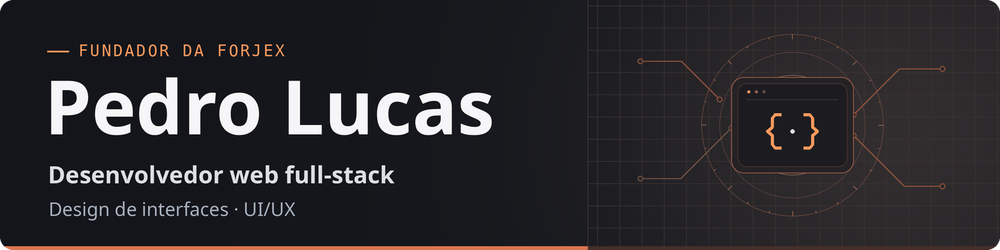

  

  
  
  

## Sobre mim

Sou um futuro desenvolvedor web full-stack, designer UI/UX e fundador da **Forjex**. Crio sites, landing pages e sistemas web sob medida. Minha experiência com design gráfico e identidade visual também orienta meu trabalho no código, da hierarquia de uma página ao fluxo de um pedido no ponto de venda.

- **Em Formação** · Análise e Desenvolvimento de Sistemas, 3º período, na FICR.
- **Residência em tecnologia** · Porto Digital, squads 45 e 21.
- **Áreas de atuação** · Desenvolvimento web, design de interfaces, gestão de estoque e automação de atendimento.

## Projetos em destaque

| Projeto | O que estou desenvolvendo |
| --- | --- |
| [Gestão Operacional & PDV](https://github.com/Pedro-Lucas001/gestao-pvd) | Sistema para lanchonetes que conecta o cardápio digital à operação da loja, com fluxo de pedidos, acompanhamento pela cozinha e gestão de entregas. |
| [Forjex](https://github.com/Pedro-Lucas001/Forjex) | Site institucional que apresenta a marca e seus serviços de desenvolvimento web, design e identidade visual. |
| [Crypto Dashboard Pro](https://github.com/Pedro-Lucas001/crypto-dashboard-pro) | Dashboard para acompanhar cotações de criptomoedas, com favoritos e alertas de preço em desenvolvimento. |

[Ver todos os repositórios →](https://github.com/Pedro-Lucas001?tab=repositories)

## Tecnologias e ferramentas

**Front-end e design**

HTML5 · CSS3 · JavaScript · Figma

**Back-end e dados**

Node.js · Java · PHP · Supabase · SQL Server

## Atividade no GitHub

  
  

  

<picture>
  <source media="(prefers-color-scheme: dark)"
          srcset="https://raw.githubusercontent.com/Pedro-Lucas001/Pedro-Lucas001/output/snake-dark.svg">
  
</picture>
